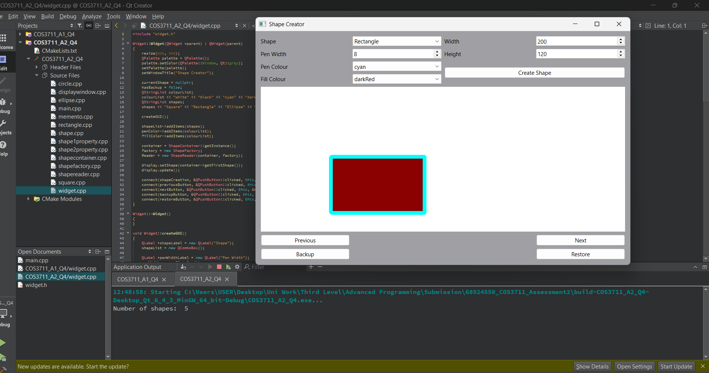

# QtShapeCreator

# Shape Creator

## Project Overview
Shape Creator is a C++ desktop application developed using Qt Widgets. It allows users to create, customise, display and navigate between different geometric shapes. The project demonstrates object-oriented programming, inheritance, polymorphism, XML parsing and software design patterns.

## Features
- **Shape Creation:** Create squares, rectangles, circles and ellipses with custom dimensions, pen widths, outline colours and fill colours.
- **Shape Navigation:** Move forwards and backwards through the collection of created shapes.
- **XML Importing:** Import predefined shapes from an XML file using Qt's DOM API.
- **Backup and Restoration:** Save and restore the state of the shape collection using the Memento design pattern.
- **Graphical Rendering:** Display shapes using Qt's QPainter framework.

## Technical Implementation

The application uses an inheritance hierarchy consisting of abstract base classes and concrete shape classes. Each shape implements its own drawing functionality using Qt graphical classes such as QPen and QRectF.

The application is organised around several key components:

- **Widget:** Provides the graphical user interface, handles user input and coordinates application functionality.
- **DisplayWindow:** Uses QPainter to render the currently selected shape.
- **ShapeContainer:** Maintains the collection of shapes, handles navigation and manages backup and restoration.
- **ShapeFactory:** Creates concrete shape objects based on user selections.
- **ShapeReader:** Reads XML data and constructs shapes using the factory.

## Design Patterns
The project implements three design patterns:

- **Singleton:** Ensures that only one ShapeContainer instance manages the application's shape collection.
- **Factory Method:** Encapsulates shape creation and delegates object instantiation to the appropriate concrete shape classes.
- **Memento:** Provides backup and restoration functionality by preserving the state of the shape collection.

## Technologies
- C++
- Qt Widgets
- Qt GUI (QPainter, QPen, QRectF)
- Qt XML (QDomDocument)
- Object-Oriented Programming
- CMake

## Learning Outcomes
This project provided practical experience with inheritance, abstract classes, polymorphism, dynamic object creation, XML processing, graphical rendering and the application of design patterns in a desktop software environment.
